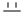

# Design icons

Generated by `tool/new_ui/extract_icons.py` from the boards in `reference/`. Use these files (with `flutter_svg`), not Material icons. Rename an `icon_<n>` file to what it shows the first time you use it, and update this table.

| Icon | File | Labels on the boards | Boards |
|---|---|---|---|
|  | `assets/icons/back_to_explore.svg` | Back to Explore, Back | BehindTheWork, CollectedBadge, Conversation, EvCheckout, EvMyTickets, EvPast, EvSoldOut, EvTicket, EventPage, ListPricing, MessagePiece, NotifActivity, NotifEmptyActivity, NotifEmptyMessages, NotifMessages, NotifSettings, PieceMadeWith, PostAvailAuction, PostAvailFixed, PostCover, PostDetailsForSale, PostDetailsProgress, PostMaterials, PostMaterialsSearch, PostNFSAvail, PostNFSDetails, PostNFSReview, PostRelatedScenes, PostReview, ProfileCollector, ProfileOwn, ProfileSeller, SavedAvailable, SavedCollection, SavedEmpty, SavedFolder, SavedFolderMenu, SavedHoldMenu, SceneCover, SceneDetails, ScenePhotoDetails, ScenePhotoEdit, ScenePhotoEditSize, SceneTrim, SignIn1Sheet, SignIn2Code, SignIn3Profile, SignIn4Intention, SignIn5Done |
|  | `assets/icons/search_behind_the_work.svg` | Search Behind the work | BehindTheWork, BuyAddress, Explore, NewMessage, NotifMessages, PostLocation, PostMaterials, PostMaterialsSearch, PostMedium |
|  | `assets/icons/video.svg` | Video | BehindTheWork, Explore, PostRelatedScenes, ScenePosted, SceneTrim |
|  | `assets/icons/reels.svg` | Reels | App nav only. The board has no Reels slot; this is a 24 px stroke-1.8 outline in that icon's style. |
|  | `assets/icons/home.svg` | Home | BehindTheWork, CollectedBadge, Explore, Main, ProfileCollector, ProfileOwn, ProfileSeller, ProfileSignedOut |
|  | `assets/icons/explore.svg` | Explore | BehindTheWork, CollectedBadge, Explore, Main, ProfileCollector, ProfileOwn, ProfileSeller, ProfileSignedOut |
|  | `assets/icons/post.svg` | Post, New message, Add a profile photo | BehindTheWork, CollectedBadge, Explore, Main, NotifEmptyMessages, ProfileCollector, ProfileOwn, ProfileSeller, ProfileSignedOut, SignIn3Profile |
|  | `assets/icons/events.svg` | Events | BehindTheWork, CollectedBadge, Explore, Main, ProfileCollector, ProfileOwn, ProfileSeller, ProfileSignedOut |
|  | `assets/icons/close.svg` | Close, Remove Oil paint, Remove Linen canvas, Remove Cold wax medium, Remove Palette knife | BidCheckout, BidCollected, BidLost, BidReserveNotMet, BidSecondChance, BidWon, CollectConfirm, EvConfirmed, ListDone, PostError, PostMaterials, PostNFSDone, PostSuccess, ScenePhotoPosted, ScenePosted |
|  | `assets/icons/required.svg` | required, More | BidCheckout, BuyCheckoutEmpty, BuyCheckoutReady, PostDetailsForSale, PostDetailsProgress, PostListLater, PostNFSDetails, ProfileSignedOut, SceneDetails, ScenePhotoDetails, ScenePhotoPosted, ScenePosted |
|  | `assets/icons/back.svg` | Back | BidLeading, BidOutbid, BuyAddress, BuyPiece, BuyPieceFull, BuyPieceScrolled, BuyShipping, ListOwnerPiece, PieceNotForSale |
|  | `assets/icons/save.svg` | Save, Saved | BidLeading, BidOutbid, BuyPiece, BuyPieceFull, BuyPieceScrolled, Main, PieceMadeWith, PieceNotForSale, SavedHoldMenu |
|  | `assets/icons/share.svg` | Share | BidLeading, BidOutbid, BuyPiece, BuyPieceFull, BuyPieceScrolled, ListOwnerPiece, PieceNotForSale, SavedHoldMenu |
|  | `assets/icons/more.svg` | More | BidLeading, BidOutbid, BuyPiece, BuyPieceFull, BuyPieceScrolled, ListOwnerPiece, PieceNotForSale |
|  | `assets/icons/icon_14.svg` | — | BidLeading, BidOutbid, BuyPiece, BuyPieceFull, BuyPieceScrolled, ListOwnerPiece, PieceNotForSale |
|  | `assets/icons/chat.svg` | Message the seller about this piece | BidLeading, BidOutbid, BuyPiece, BuyPieceFull, BuyPieceScrolled |
|  | `assets/icons/info.svg` | What is the reserve?, What is insurance?, What is the commission?, What is auction timing?, What is a reserve price?, What is weight?, What is framing?, What is location?, What is style?, What are materials and tools?, What is related scenes?, What is linked pieces? | BidSheet, BuyShipping, ListPricing, PostAvailAuction, PostAvailFixed, PostDetailsForSale, PostListLater, PostNFSDetails, SceneDetails, ScenePhotoDetails |
|  | `assets/icons/icon_17.svg` | — | BuyAddress |
|  | `assets/icons/close_2.svg` | Close | BuyCheckoutEmpty, BuyCheckoutReady |
|  | `assets/icons/more_2.svg` | More | CollectedBadge, ProfileCollector, ProfileOwn, ProfileSeller |
|  | `assets/icons/icon_20.svg` | — | ConvMenu |
|  | `assets/icons/profile.svg` | Profile | ConvMenu, ProfileSignedOut |
|  | `assets/icons/block.svg` | — | ConvMenu |
|  | `assets/icons/report.svg` | — | ConvMenu |
|  | `assets/icons/conversation_options.svg` | Conversation options, Folder options | Conversation, SavedFolderMenu, SavedHoldMenu |
|  | `assets/icons/attach_a_photo_or_video.svg` | Attach a photo or video, New message, New folder | Conversation, NotifMessages, SavedCollection |
|  | `assets/icons/send.svg` | Send | Conversation, MessagePiece |
|  | `assets/icons/icon_27.svg` | — | EvCheckout, EvMyTickets |
|  | `assets/icons/ticket_qr_code.svg` | Ticket QR code | EvTicket |
|  | `assets/icons/share_bold.svg` | Share | EventPage, ListDone, PostNFSDone, PostSuccess, ScenePhotoPosted, ScenePosted |
|  | `assets/icons/icon_30.svg` | — | EventPage |
|  | `assets/icons/icon_31.svg` | — | EventPage |
|  | `assets/icons/icon_32.svg` | — | ListDone, PostNFSDone, PostSuccess |
|  | `assets/icons/edit_piece.svg` | Edit piece | ListOwnerPiece |
|  | `assets/icons/filter_feed.svg` | Filter feed | Main |
|  | `assets/icons/inbox_unread_items.svg` | Inbox, unread items | Main |
|  | `assets/icons/layers.svg` | piece count on a series card | Main |
|  | `assets/icons/arrow_right.svg` | — | Main, NotifEmptyActivity, NotifEmptyMessages, SavedEmpty |
|  | `assets/icons/remove_piece.svg` | Remove piece | MessagePiece |
|  | `assets/icons/muted.svg` | Muted | NotifMessages |
|  | `assets/icons/add_a_photo.svg` | Add a photo | PostCover, SavedSheet |
|  | `assets/icons/location.svg` | — | PostLocation |
|  | `assets/icons/add_bold.svg` | — | PostMaterials, PostMaterialsSearch |
|  | `assets/icons/icon_43.svg` | — | ProfileOwn |
|  | `assets/icons/icon_44.svg` | — | ProfileOwn |
|  | `assets/icons/settings.svg` | Settings | ProfileSignedOut |
|  | `assets/icons/rename_folder.svg` | Rename folder | SavedFolderMenu |
|  | `assets/icons/delete_folder.svg` | Delete folder | SavedFolderMenu |
|  | `assets/icons/folder.svg` | Move to folder | SavedHoldMenu |
|  | `assets/icons/unlink.svg` | Unlink Bodies in Color, Unlink Companion Bloom | SceneDetails, ScenePhotoDetails |
|  | `assets/icons/icon_50.svg` | — | SceneDetails, ScenePhotoDetails |
|  | `assets/icons/save_2.svg` | Save | SignIn1Sheet |
|  | `assets/icons/chevron_right.svg` | — | SignIn1Sheet, SignIn5Done |
|  | `assets/icons/check.svg` | — | SignIn3Profile, SignIn5Done |
|  | `assets/icons/saved.svg` | Saved | SignIn5Done |

## Added for app features no board draws

Same style as the board icons (24 grid, stroke 1.8, round caps). Not regenerated by `extract_icons.py`.

| Icon | File | Used for |
|---|---|---|
|  | `assets/icons/like.svg` | Like on the piece page (kept, rule 4) |
|  | `assets/icons/liked.svg` | Liked state (filled Ink) |
|  | `assets/icons/link.svg` | Copy link in the share sheet |
